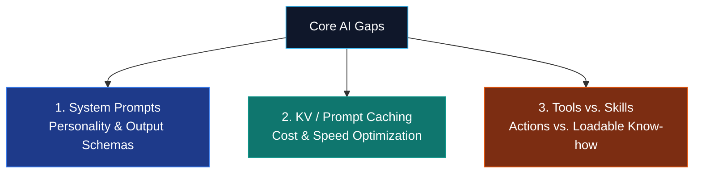

# Core Knowledge Gaps & Study Guide

This document tracks specific, high-priority conceptual gaps you have identified: **System Prompts**, **KV / Prompt Caching**, and **Tools vs. Agent Skills**. 

Use this guide as a quick reference to understand how they work, why they are important, and how to programmatically implement them as you progress through the Labs.

---



---

## 🧠 1. System Prompts (The Personality & Rules Engine)

### What Is It?
In modern LLM chat APIs, the **System Prompt** is a separate, high-level instruction block that is processed before the conversation begins. Think of it as the **firmware** or **compiler constraints** of the model, whereas the user's prompt represents the **runtime variables**.

### Why Is It Critical?
*   **Behavioral Constraints:** Prevents the model from breaking character or discussing unsafe topics.
*   **Output Schemas:** Forces the model to respond in exact, structured formats (like JSON) rather than conversational text.
*   **Role-Play Alignment:** Steers the model to act as a senior auditor, a customer representative, or a compiler, drastically changing the quality of output.

### How to Implement It
In your code, never put system instructions inside the standard `messages` array if the SDK supports a top-level `system` argument.

#### 🐍 Python Example (Anthropic SDK):
```python
import anthropic

client = anthropic.Anthropic()

response = client.messages.create(
    model="claude-sonnet-5-5",
    max_tokens=1024,
    # System Prompt defined outside the messages array
    system="""You are a strict code review assistant. 
    Analyze the user's input ONLY for SQL injection vulnerabilities.
    Respond exclusively in valid JSON format:
    {
        "vulnerable": true/false,
        "explanation": "string details"
    }""",
    messages=[
        {"role": "user", "content": "SELECT * FROM users WHERE username = '" + user_input + "'"}
    ]
)
print(response.content[0].text)
```

---

## ⚡ 2. KV / Prompt Caching (Cost & Speed Optimization)

### What Is It?
When an LLM processes your prompt, it converts it into key-value (KV) states (called the **KV Cache**) so it doesn't have to recompute those tokens on subsequent steps of the conversation. **Prompt Caching** allows the provider to cache these KV states *across different API calls* for multiple minutes.

### Why Is It Critical?
*   **Massive Cost Savings:** Reduces your input token bill by up to **90%**.
*   **Massive Latency Reduction:** Lowers model response time by up to **80%**.
*   **Enables Huge Contexts:** Makes uploading 100-page PDF manuals, complete codebases, or database schemas feasible and affordable on every single call.

### How to Implement It
To trigger caching, your system prompt or long context block **must be longer than a model-specific minimum** (1,024 tokens or more, depending on the model — check the current docs) and placed at the top of the prompt. You add a `cache_control` tag to the block you want the provider to remember.

#### 🐍 Python Example (Anthropic SDK):
```python
response = client.messages.create(
    model="claude-sonnet-5-5",
    max_tokens=1024,
    system=[
        {
            "type": "text",
            "text": "You are a helpful analyst."
        },
        {
            "type": "text",
            "text": "Here is the complete company employee manual: " + massive_employee_manual_text,
            "cache_control": {"type": "ephemeral"} # <--- Tells Claude to cache this huge block!
        }
    ],
    messages=[
        {"role": "user", "content": "What is the policy on annual leave?"}
    ]
)
# Note: Subsequent calls querying the same manual will hit the cache, costing 90% less.
```

---

## 🛠️ 3. Tools vs. Agent Skills (Two Different Primitives)

### What Is It?
These two are easy to confuse — an earlier version of this guide described tools and called them Skills.

*   A **tool** is a function your code exposes to the model. The model asks for it to be called; your code (or a client like Claude Code) runs it and sends back the result. The tool's name, description and input schema go with **every** request.
*   An **Agent Skill** is a folder with a `SKILL.md` file: instructions, and optionally scripts or reference files, that teach the model *how* to do a kind of task. Only its short `description` sits in context; the body loads when the skill is triggered.

| | Tool | Skill |
|---|---|---|
| What it gives the model | An action it can take | Know-how it can load |
| Context cost | Schema on every request | Description only, until triggered |
| Who runs it | Your code, when the model asks | The model reads and follows it |
| Example in this repo | The MCP server in Lab 6 | [`/lab-notes`](../.claude/skills/lab-notes/SKILL.md) |

### Why Is It Critical?
*   **Tools bypass model limits:** live data, local files, databases, exact calculations.
*   **MCP standardises tools:** write a tool once and use it from Claude Code, Cursor, or your own code.
*   **Skills keep context lean:** 20 skills cost almost nothing until used, while 20 tools tax every request. That trade-off is a context-engineering decision (concept #35), and Lab 6.4 measures it.

### How to Implement a Tool
Write a normal function with clear type hints and a docstring. The framework turns them into the JSON schema the model sees.

#### 🐍 Python Example (FastMCP Tool):
```python
from fastmcp import FastMCP
import requests

mcp = FastMCP("My Weather & Calendar Server")

# The LLM reads the function name, docstring, and argument types as its instruction manual!
@mcp.tool()
def get_local_weather(city: str) -> str:
    """
    Fetch the live weather forecast for a specified city.
    
    Args:
        city: The name of the city (e.g., 'Paris', 'New York').
    """
    # Exposing a real web action to the LLM
    response = requests.get(f"https://wttr.in/{city}?format=3")
    return response.text

if __name__ == "__main__":
    mcp.run()
```

### How to Implement a Skill
Create `.claude/skills/<name>/SKILL.md`. The frontmatter `description` is what the model sees up front, so it must say when to use the skill.

```markdown
---
name: shop-analysis
description: Analyse the retailer's returns and reviews. Use when the user asks about return rates, complaint themes, or refund trends.
---

# Shop analysis
1. Query `shop.db` for return counts by product category.
2. Pull 3 representative review quotes per category.
3. Report as a table plus a short paragraph per category.
```

---

## 🎯 Gap-to-Lab Mapping Tracker

Use this checklist to ensure you have actively practiced and mastered these components:

- [ ] **System Prompts Mastered:**
    *   *Practiced In:* **Lab 1.3** (system parameter vs. messages placement) & **Lab 2.1** (extraction instructions).
    *   *Advanced Practice:* **Lab 7.1** (schema-grounded SQL prompts) & **Lab 8** (agent role prompts).
- [ ] **KV / Prompt Caching Mastered:**
    *   *Practiced In:* **Lab 2.2** (caching the extraction rubric and few-shot examples).
    *   *Advanced Practice:* **Lab 5.3** (caching a long context) & **Lab 7.1** (caching the database schema).
- [ ] **Tools Mastered:**
    *   *Practiced In:* **Lab 6.1** (the tool loop by hand) & **Labs 6.2–6.3** (an MCP server, built and broken).
    *   *Advanced Practice:* **Lab 7** (SQL agent tools and an approval-gated action tool) & **Lab 8** (tools shared across a team).
- [ ] **Agent Skills Mastered:**
    *   *Practiced In:* **Lab 6.4** (a skill vs. an MCP server, measured in context tokens).
    *   *Study Example:* this repo's [`/lab-notes`](../.claude/skills/lab-notes/SKILL.md) skill.
